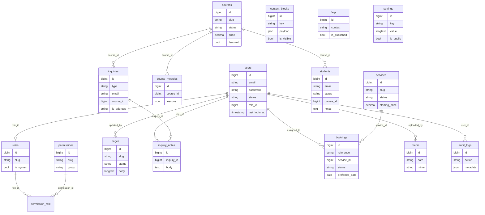

# Marqetise audit

Date: 22 October 2026. Read-only. No application code was changed.

This report judges the code that is in the repository. The public app is a Vite React SPA, not a Next.js app. There is no `next.config`, no App Router, and no Next.js middleware.

## Skills used

There is no `.claude/skills`, `.agents/skills`, `.kilo`, or `.windsurf` directory in this repository, and no `SKILL.md` under the project.

| Area | Skill used |
| --- | --- |
| Laravel routes, authorization, validation, sessions, OWASP, database, quality | None in the repo. Reviewed from the source and from `php artisan route:list`. |
| Frontend architecture and security | None in the repo. |
| Unfinished business logic | None in the repo. |
| UI, motion, typography, reduced motion, HIG | `apple-design` (user skill library). Used for response latency, reduced motion, touch size, hierarchy, materials, and type. |
| Design-mockup comparison | `pdf`. `marqetise-ui-diagrams.pdf` is at the repo root, 16 pages, no extractable text. Pages were rendered and read as images. |
| Content integrity | None in the repo. |

The Cursor security-review subagent was not used. It reviews a diff, and this is a full-tree audit.

## Stack and how sign-in works

| Piece | What is installed |
| --- | --- |
| Public site and admin | React 19.3, React Router 7.18, Vite 8.3, Tailwind CSS 4.3, Axios, React Hook Form, Zod. No TypeScript project and no `typecheck` script. |
| API | Laravel 13.17, PHP 8.3, Laravel Sanctum 4, MySQL in `.env.example`, PHPUnit on SQLite in memory. |
| Auth | Sanctum SPA session cookie. Not a bearer token stored in the browser. |
| Mail | Default `MAIL_MAILER=log`. Inquiry and booking mail is skipped unless the mailer is a real transport. Password-reset mail still goes through Laravel's mailer, so the log driver writes the reset link. |
| Queue | `QUEUE_CONNECTION=database` and a `jobs` table exist. No application job class sends mail. Mail is sent inside the HTTP request. |

Sign-in path:

1. The browser stays on the Vite origin. `frontend/vite.config.js` proxies `/api`, `/sanctum`, `/storage`, `/sitemap.xml`, and `/robots.txt` to Laravel.
2. `frontend/src/services/api.js` creates Axios with `withCredentials: true`. `ensureCsrf()` calls `GET /sanctum/csrf-cookie` before a state-changing request.
3. `backend/bootstrap/app.php` calls `statefulApi()`. That puts `EnsureFrontendRequestsAreStateful` on the `api` group (`vendor/laravel/framework/src/Illuminate/Foundation/Configuration/Middleware.php` lines 495–498). For a request whose `Origin` or `Referer` is a Sanctum stateful domain, that middleware starts the session and checks the CSRF token.
4. `POST /api/v1/auth/login` uses `Auth::attempt` and then `$request->session()->regenerate()` (`backend/app/Http/Controllers/Api/V1/AuthController.php` lines 22 and 43).
5. The React app stores the user in memory (`AuthContext`). It does not write a token to `localStorage` or `sessionStorage`.
6. Admin screens use a client `RequireAuth` guard (`frontend/src/App.jsx` lines 33–56). The API repeats the check with `auth:sanctum`, `active`, and `permission:*`.

`php artisan route:list` shows the `api` group does not include `throttle`. `throttleApi()` is never called. Only login, forgot-password, reset-password, inquiries, and bookings add a limiter.

Local `backend/.env` is gitignored. `git ls-files` and `git log --all` show no tracked `.env`. Local flags, with secret values omitted: `APP_ENV=local`, `APP_DEBUG=true`, `APP_KEY` is set, `DB_PASSWORD` is empty, `SESSION_SECURE_COOKIE=false`, `SESSION_ENCRYPT=false`, `SESSION_LIFETIME=120`, `MAIL_MAILER=log`, `SEED_SAMPLE_CONTENT=true`. That is a local Laragon file, not a production config. `docs/DEPLOYMENT.md` tells production to turn debug off and set the secure cookie.

## Commands that were run

Dependencies were already installed (`backend/vendor`, `frontend/node_modules`). Nothing was reinstalled.

| Command | Result |
| --- | --- |
| `php artisan test` (PHP 8.3.26) | Passed. 12 tests, 27 assertions, 15869 ms. |
| `npm run lint` (`oxlint`) | Exit 0. 9 warnings, 0 errors. Warnings are React Compiler / `setState` in effects, a missing `form` dependency in `BookPage.jsx`, and files that export both components and helpers. |
| `npm test` (`vitest run`) | Passed. 2 files, 3 tests, about 40 s. |
| `npm run build` | Passed in 1.53 s. Largest JS: `dist/assets/index-CfFtF4Kj.js` 337.51 kB (gzip 108.07 kB) and `forms-B7Yi7twU.js` 116.01 kB (gzip 35.38 kB). CSS 47.20 kB (gzip 16.06 kB). Plus Jakarta Sans ships four weights, including Vietnamese and Latin-ext files. |
| Typecheck | Not run. There is no `tsconfig` and no typecheck script. Source is JSX. |
| `composer audit` | `No security vulnerability advisories found.` |
| `npm audit` in `frontend/` | `found 0 vulnerabilities` |
| `npm audit` in `backend/` | Failed: `ENOLOCK`. `backend/` has no `package-lock.json`. |

The PHPUnit suite does not cover the privilege-escalation path below. `backend/tests/Unit/ExampleTest.php` asserts that `true` is `true`.

## 1. Executive summary

The application is a real staff tool, not a clickable mock. Public inquiries and bookings are validated, stored, and described as requests rather than payments. Draft pages and draft courses stay off the public API. Passwords are hashed, hidden from JSON, and never returned. HTML in CMS fields is stripped before save, and the public UI renders page bodies as text.

It is not safe to put on the public internet as it stands. An Administrator can change a Super Administrator's email through the API and then take that account with the password-reset flow. Password changes leave other sessions and the remember-me cookie valid. The dashboard returns counts for students, users, inquiries, and bookings to any role that can open the dashboard. The default log mailer writes reset links into `laravel.log`, and the forgot-password response tells the caller that.

Overall health: **6 / 10**. Useful locally. Not production-ready.

| Area | Score | Why |
| --- | --- | --- |
| Backend security | 5 / 10 | Sanctum, CSRF, permission middleware, FormRequests, and output hiding are in place. The Super Admin takeover and the dashboard leak break the permission model. |
| Frontend security | 7 / 10 | Cookie session, no token in browser storage, no `dangerouslySetInnerHTML`. Route protection is client-side only. No CSP. |
| Business logic | 6 / 10 | Contact, course enquiry, and pending bookings work and do not fake a payment. Services, FAQs, and content blocks cannot be edited in the admin UI. Enquiry pre-selection does not match the mockup URL. |
| UI / HIG | 5 / 10 | Hierarchy, focus rings, skip link, and reduced-motion handling exist. Tables scroll sideways, many targets are under 44px, loading is a spinner rather than a skeleton, and several screens are thinner than the mockups. |
| Content integrity | 7 / 10 | Testimonials and statistic blocks are seeded hidden and empty. Privacy and terms are published while they still say they are unfinished. Sample courses with prices publish when `SEED_SAMPLE_CONTENT=true`. |
| Code quality | 6 / 10 | Controllers are small and writes use FormRequests. Tests are a thin slice. Mail is synchronous. Settings reads query the database once per key. |

### Top 5 risks

1. **Critical.** An Administrator can replace a Super Administrator's email, including the last remaining Super Administrator, and then reset that password.
2. **High.** Changing or resetting a password does not invalidate other sessions or rotate the remember-me token.
3. **High.** `GET /api/v1/admin/dashboard` returns student, user, inquiry, and booking figures to every role with `dashboard.view`, including Content Editor.
4. **High.** With the default `log` mailer, invitation and reset links are written to `storage/logs/laravel.log`. The public forgot-password response says so.
5. **High.** Production cookie and browser hardening is not enforced in code: `SESSION_SECURE_COOKIE` defaults off in the env template, CORS always allows credentialed `localhost:5173`, and the app sets no CSP or other security headers.

### Brand conflict to resolve before any visual fix

The written brief says the public site is near-black `#101010` / `#181818` with orange `#FF6B2C` / `#FF8A45`, and that admin primary actions are orange, with royal blue only in the logo.

`marqetise-ui-diagrams.pdf` says something else. Its design-system page and admin mockups label primary blue `#113DDA` and accent orange `#F36A09`. Admin "Sign in" and other primary buttons in the mockups are blue. The public heroes are dark navy, not `#101010`. The home mockup's statistics, testimonials, phone number, and street address are marked sample data.

The code follows the PDF more than the brief: `--color-brand: #f36a09` matches the PDF orange, and `--color-blue: #113da5` is close to `#113DDA` but not the same (`frontend/src/index.css` lines 4–15). Public pages use `bg-navy-950` (`#070b14`) and `bg-navy-900` (`#0b1220`). Admin buttons in the CMS, users, and settings screens use `variant="blue"`.

Do not treat this as a defect until you pick one source. Phase 3 should wait on that choice.

## 2. Findings

| ID | Area | Severity | Location | Issue | Evidence | Fix |
| --- | --- | --- | --- | --- | --- | --- |
| F-01 | Authorization | Critical | `UserController.php:83-100`, `StaffAccountGuard.php:35-48`, `PermissionCatalog.php:50-57`, `AuthController.php:66-71` | An Administrator can take over a Super Administrator. | Administrator has every permission except `roles.manage`, including `users.manage`. `update()` copies `email` onto the target. `assertCanChangeStatus()` returns immediately when the target is not the last active Super Admin. When the target is the last one, it only blocks a status change or a role change. An email-only update is allowed. `forgotPassword()` then sends a reset link unless the account is suspended. Delete is protected (`UserController.php:110`); update is not. The users screen only exposes Suspend, so this is an API call, not a button. The server is the control. | Refuse email, role, and status changes on a Super Administrator unless the actor is a Super Administrator. Add a feature test for the last Super Admin and for a second one. |
| F-02 | Sessions | High | `AccountController.php:17-24`, `AuthController.php:82-92` | A stolen session or remember-me cookie survives a password change. | Login supports `remember` (`AuthController.php:22`). Reset and account update assign a new password through the `hashed` cast and do not call `logoutOtherDevices()` or rotate `remember_token`. Logout itself does invalidate the current session (`AuthController.php:54-56`). Login does regenerate (`line 43`). | On password change and reset, invalidate other sessions and rotate the remember token. Keep the current session only after a confirmed password change. |
| F-03 | Authorization | High | `DashboardController.php:34-61` vs `62-91` | Dashboard totals ignore the permissions used everywhere else. | `counts` always includes students, active students, users, new inquiries, and pending bookings. `enrolment_trend` and `course_enrolments` always include student counts. Recent rows are permission-checked. Content Editor has `dashboard.view` and does not have `students.view`, `users.view`, `inquiries.view`, or `bookings.view` (`PermissionCatalog.php:59-66`). | Return each block only when the caller has the matching `.view` permission. Add a test that a Content Editor does not receive student or inquiry counts. |
| F-04 | Auth / logging | High | `AuthController.php:66-77`, `UserController.php:60-73`, `MailStatus.php:12-14`, `.env.example:54` | Reset and invitation links are written to the log, and the API announces it. | `MailStatus` treats `log` and `array` as undeliverable and skips inquiry mail. `Password::broker()->sendResetLink()` does not use `MailStatus`, so the log driver records the full message, including the token URL. The public forgot-password JSON includes `email_configured` and the sentence "the link is written to the application log." Local `.env` has `MAIL_MAILER=log`. | Never write reset URLs to the log. If mail cannot be delivered, tell an already-authenticated admin, not an anonymous caller. Keep the public response identical whether or not the mailbox exists. |
| F-05 | Sessions / CORS | High | `config/cors.php:11-25`, `config/session.php:172`, `.env.example:36-37`, `EnsureFrontendRequestsAreStateful.php:36-40` | A copied env template leaves the session cookie usable on plain HTTP, and production CORS trusts localhost with credentials. | `supports_credentials` is true and `http://localhost:5173` plus `http://127.0.0.1:5173` are always merged with `FRONTEND_URL`. A page on localhost can call a public API with the victim's production cookie. `SESSION_SECURE_COOKIE` is false in the example and in the local env. Sanctum forces `http_only` and `same_site=lax` for API requests; it does not force `secure`. Session payload encryption is off (`session.php:50`). | In production, allow only the real origin, set `Secure`, and fail boot if `APP_DEBUG` is true or `SESSION_SECURE_COOKIE` is false. Keep localhost only when `APP_ENV=local`. |
| F-06 | Headers | Medium | `bootstrap/app.php`, `frontend/vite.config.js` | No CSP, `X-Frame-Options` / `frame-ancestors`, `Referrer-Policy`, or `X-Content-Type-Options` in the app or the Vite config. | Searched the app and frontend for those header names. No matches. Private-disk downloads in the framework set a CSP; HTML responses do not. | Add a small header middleware for the API and document the same headers for the static host. Start with a CSP that fits this SPA. |
| F-07 | Rate limiting | Medium | `AppServiceProvider.php:29-37`, `routes/api.php:26-37`, `Middleware.php:495-498` | Login is limited to 5 requests a minute per email and IP, then the window resets. Public reads are not limited. | There is no persistent lockout. `throttleApi()` is not enabled, so `GET /api/v1/site`, courses, services, and pages have no throttle. Inquiry and booking POSTs use `throttle:inquiries` at 5 per minute per IP. | Keep the 5/minute cap. Add a longer lockout after repeated failures. Add a generous read throttle on public GETs. |
| F-08 | Data exposure | Medium | `PageResource.php:23`, `PublicCatalogController.php:53-55` | A published page response includes the staff editor's name. | `editor` is read as `$this->editor?->name`, not `whenLoaded`, so the public page endpoint lazy-loads `users`. | Omit `editor` unless the caller is staff. |
| F-09 | Student data | Medium | `StudentResource.php:12-28`, migration `2026_10_20_220000` students table, `PermissionCatalog.php:92-96` | Student name, email, phone, and notes are plaintext. Any `students.view` role sees every student. | No encryption cast, no column encryption, no owner scope. Read-Only Staff receives every `.view` permission, including students and users. Inquiry rows also store `ip_address`. This matches a shared staff desk, and it is broader than a per-instructor roster. | Confirm whether Instructor and Read-Only should see every learner. If not, scope queries. Do not log notes or message bodies. |
| F-10 | IDOR model | Low | Admin `show` methods, for example `StudentController.php:41` area and `BookingController.php:44-46` | There is no per-record owner check. | Any caller with the `.view` permission can open any id of that type. Booking `internal_notes` are included for every `bookings.view` caller (`BookingResource.php:32`). That is consistent with one shared inbox. It is not consistent with "this instructor sees only their learners." | Leave the shared-inbox model if that is the product. If instructors are isolated, filter `course_id` / `assigned_to` on the server. |
| F-11 | CMS | High | `frontend/src/pages/admin/CmsPages.jsx:82-138` | Staff cannot edit or publish a service, FAQ, or content block from the UI. | The API has `PUT` for all three. The UI only `POST`s and `DELETE`s. New FAQs are sent with `is_published: true`. The service form never shows `status`, and state defaults to `draft`, so a new service stays unpublished and cannot be opened again to publish it. Pages and courses do have editors. | Add edit forms that call the existing `PUT` routes, including draft versus published. |
| F-12 | Enquiries | Medium | `CourseDetailPage.jsx:56`, `ContactPage.jsx:19-28`, PDF page 1 and page 7 | Course pre-selection works only for this app's query string, not the mockup's. There is no service-type enquiry. | The button links to `/contact?type=course&course={id}&subject=...`. The sitemap in the PDF uses `?enquiry=course&course={slug}`. Nothing in `frontend/src` links to `type=corporate`. Enquiry types are `contact`, `course`, and `corporate` (`StoreInquiryRequest.php:27`). The mockup also has a marketing-service enquiry. Services are chosen on `/book/:slug` instead. | Decide the canonical query and the enquiry types. Accept the chosen params on the server and the form. Do not invent a payment step. |
| F-13 | Errors | Medium | `CourseDetailPage.jsx:22`, `CmsPage.jsx:17`, `RecordPages.jsx:136-146`, `RecordPages.jsx:267-279` | Failed loads look like missing pages, and several saves ignore API errors. | Any Axios failure sets `missing`. Booking review and student profile `await api.patch/put` with no `catch`, and the profile always shows Save. The student route only requires `students.view` (`App.jsx:87`). Instructor has view, not manage, so Save returns 403 and the screen stays silent. | Separate 404 from network failure. Catch errors and show them. Hide Save unless the user has the manage permission. |
| F-14 | Students | Medium | `RecordPages.jsx:199-250` and `258-294` | A student cannot be attached to a course from the profile UI, and "Create student" can duplicate rows. | The add form has no course field. The profile posts `course_id` from the loaded record and has no course control. `InquiryController::createStudent` (`lines 67-81`) inserts a new row every time, with no unique email and no link back to the inquiry. | Add the course field. Make create-from-inquiry idempotent, or link `inquiry_id`. |
| F-15 | Email | Medium | `PublicInquiryController.php:25-32`, `MailStatus.php:16-24`, `InquiryReceived.php:12-15` | Staff email is synchronous and off until both a real mailer and `notification_email` are set. The visitor does not get a receipt. | `Mail::to()->send()` runs in the request. The mailable does not implement `ShouldQueue`. `SettingsSeeder.php:35-37` stores `notification_email` as null. The JSON message tells the visitor when mail was not sent. That part is honest. | Queue staff mail after you confirm the queue worker will run. Ask whether the visitor should get a receipt. Do not show a receipt you did not send. |
| F-16 | UI states | Medium | `components/ui.jsx:64-70`, admin list pages | Loading is a spinner. The dashboard mockup shows skeletons. Empty and error states exist on the main admin lists and on courses. | `Spinner` is the shared loading UI. `EmptyState` is used for empty admin tables. Home shows a site-load error (`HomePage.jsx:56`). About does not. Bookings with a failed `/services` call render an empty service list and no error (`BookPage.jsx:32-33`). | Use skeletons for dashboard and list loads. Show an error when services or site content fail. |
| F-17 | Mobile / HIG | Medium | `PublicLayout.jsx:35`, `BookPage.jsx:92-110`, admin tables `min-w-[640px]` through `min-w-[860px]` | Touch targets are often under 44px, and admin tables force horizontal scrolling. | Menu, Prev/Next, and calendar days use `px-3 py-2` or `py-1`. Admin tables set a minimum width inside `overflow-x-auto`. The public page column is `max-w-6xl` with `px-4`, so the marketing pages themselves do not need a sideways scroll. The mobile drawer (`AdminLayout.jsx:71-80`) has no focus trap. The mockup's admin drawer note says focus is trapped. `Modal` (`ui.jsx:73-90`) has `role="dialog"` and no focus trap or Escape handler. | Raise targets to at least 44px. Stack admin records on small screens. Trap focus in the drawer and modal. |
| F-18 | Motion / a11y | Low | `index.css:18-45`, `ui.jsx:1` | Reduced motion is handled globally. Orange text on white is weak. | `prefers-reduced-motion: reduce` collapses animation and transition duration. Focus-visible uses a 2px `#f36a09` outline. `text-brand` (`#f36a09`) on white is about 3:1, under the 4.5:1 needed for small text. It is used for "Book this service" (`HomePage.jsx:68`). Body muted `#5c6b82` on white is about 5.4:1 and passes. | Darken small orange links, or use navy/blue for text links and keep orange for large buttons. |
| F-19 | Mockup gaps | Medium | `HomePage.jsx`, `AdminLayout.jsx`, `DashboardPage.jsx`, PDF pages 1, 3, 7, 9 | Several labelled mockup regions are missing, and some sample mockup data was correctly left out. | Present: dark heroes, service cards, course cards, contact form, admin sidebar, draft/published pages. Missing versus the PDF: header "Get Started", home chart panel, map and "Book a call" on Contact, admin header search (the API route exists), dashboard quick actions, dashboard line chart. Correctly absent: the mockup's `250+`, `95%`, testimonial quotes, `hello@marqetise.com`, and `120 Market St`. Those are marked sample on the PDF. | Rebuild missing chrome only after the brand decision. Do not copy the sample numbers, quotes, or address. |
| F-20 | Content | Medium | `WebsiteContentSeeder.php:27-38`, `SettingsSeeder.php:17`, `SampleCourseSeeder.php`, `.env.example:7` | Placeholder legal copy is published, hours are invented, and sample courses have prices. | Privacy and terms are `status => published` and say to add the finished text before launch. Hours are `Weekdays, 9:00–17:00` with email, phone, and address null. `SEED_SAMPLE_CONTENT=true` in the example and the local env, so `SampleCourseSeeder` publishes courses at 199, 349, and 249. The home stats and testimonial blocks are `is_visible => false` with empty `items` (`WebsiteContentSeeder.php:92-100`). | Unpublish privacy and terms until the real text exists. Leave hours empty until confirmed. Keep sample courses off unless a person publishes them. |
| F-21 | Content | Low | `HomePage.jsx:44`, `WebsiteContentSeeder.php:83-84`, `AboutPage.jsx:17` | Some marketing lines are hardcoded or claim proof. | The home side panel always lists Search, Content, Paid media, and Training. The process block title is "A simple, proven process". The About H1 is hardcoded and does not use the CMS page body. | Move these into CMS blocks, and drop "proven" until there is a source. |
| F-22 | XSS / injection | Low | `SafeText.php:13`, `PublicCatalogController.php:33` and `75` | Stored HTML is stripped. The raw SQL that exists is bound. | `strip_tags` runs before save. Public bodies render as React text (`CmsPage.jsx:37`). `orderByRaw` uses a bound category or a fixed expression. `LIKE` terms are escaped with `addcslashes`. No `DB::raw` with concatenated user input in `app/`. No `dangerouslySetInnerHTML` in `frontend/src`. | Keep rendering text. If rich text is required later, sanitize with a whitelist on output as well as input. |
| F-23 | Uploads | Low | `UploadMediaRequest.php:17`, `MediaController.php:16-17` | Images are validated. They are stored on the public disk. | Rules: `image`, `mimes:jpg,jpeg,png,webp,gif`, `max:5120`. Permission `media.manage` is on the route and in `authorize()`. SVG is rejected. GIF is allowed. The private `local` disk has `serve => true`, and unsigned `/storage/{path}` reads and writes are rejected by `ServeFile` / `ReceiveFile` unless the URL is signed. Public files depend on `storage:link`. | Keep the allow-list. Consider dropping GIF. Confirm the web root does not expose `backend/storage` except through the public link. |
| F-24 | Quality | Medium | `PublicSiteController.php:20-22`, `DashboardController.php:20`, `tests/` | Hot paths over-fetch, and tests miss the authorization bugs. | `Setting::getValue()` runs a query per key after the settings were already loaded. The dashboard loads every student row for 12 months to count them in PHP. Feature coverage is 10 Marqetise tests plus two framework examples. Frontend coverage is login validation and one public render. | Reuse the loaded settings. Count in SQL. Add tests for F-01, F-03, draft services, and the enquiry query. |
| F-25 | Performance | Low | `main.jsx:1-4`, build output | The first JS chunk is about 108 kB gzip, plus a 35 kB forms chunk, plus four font weights. | Home is eager. Other routes are `lazy()`. Images are a single logo `` (`Brand.jsx:4-8`) without width and height. There is no image pipeline because this is not `next/image`. | Subset Plus Jakarta to latin weights you use. Split Zod to the routes that use forms. Set width and height on the logo. |
| F-26 | Auth UX | Low | `AuthController.php:31-40` | A suspended account gets a different login error than an unknown email. | Unknown and inactive-but-not-suspended users get "Incorrect email or password." Suspended users get "This account cannot sign in." Forgot-password does not reveal whether the mailbox exists, apart from `email_configured` in F-04. | Use one message for every failed login. |
| F-27 | Policies | Low | `backend/app` | There is no Policy or Gate class. | Authorization is route middleware, `FormRequest::authorize()`, and `StaffAccountGuard`. That is enough where the middleware matches the action. F-01 is the hole in the guard, not the absence of a Policy folder. | A `UserPolicy` is a good place to put the Super Admin rules so update and delete share one check. |

Not found, and checked:

- No `NEXT_PUBLIC_` variables. The only client env read is `VITE_API_URL` (`api.js:4`), documented as an optional origin.
- No password field is returned by `UserResource`. The user model hides `password` and `remember_token` (`User.php:14-15`) and hashes with the `hashed` cast at bcrypt 12 (`User.php:26`, `.env.example:18`).
- No server-side HTTP client, so the booking `website` field is stored and not fetched. No open redirect on the password-reset URL: it is built from `FRONTEND_URL` (`AppServiceProvider.php:23-26`).
- No fake payment or "you are enrolled" success. Course detail says an enquiry does not take payment or reserve a place (`CourseDetailPage.jsx:56-57`). Booking JSON says the request is pending (`PublicBookingController.php:39`).
- `composer audit` and frontend `npm audit` reported no known vulnerable packages on this date.

## 3. API inventory

Base path `/api`. Version prefix `/v1` is present. Admin list endpoints paginate (12 or 15). Public courses paginate with `per_page` capped at 24. Public services, the site payload, roles, settings, and search do not paginate. Search is capped at 5 rows per type.

The `api` middleware group is `EnsureFrontendRequestsAreStateful` plus `SubstituteBindings`. It does not include a rate limiter. CSRF runs only when the request comes from a Sanctum stateful domain.

`Auth` in the table means `auth:sanctum` + `active`. Permission middleware is additional.

| Method | URI | Controller | Middleware beyond `api` | Auth | Rate limit |
| --- | --- | --- | --- | --- | --- |
| GET | `/` | closure `web.php:7` | `web` | No | None |
| GET | `/up` | health | None | No | None |
| GET | `/sitemap.xml` | closure `web.php:15` | `web` | No | None |
| GET | `/robots.txt` | closure `web.php:44` | `web` | No | None |
| GET | `/sanctum/csrf-cookie` | Sanctum | `web` | No | None |
| GET | `/api/v1/site` | `PublicSiteController@show` | — | No | None |
| GET | `/api/v1/courses` | `PublicCatalogController@courses` | — | No | None |
| GET | `/api/v1/courses/{slug}` | `PublicCatalogController@course` | — | No | None |
| GET | `/api/v1/services` | `PublicCatalogController@services` | — | No | None |
| GET | `/api/v1/services/{slug}` | `PublicCatalogController@service` | — | No | None |
| GET | `/api/v1/pages/{slug}` | `PublicCatalogController@page` | — | No | None |
| POST | `/api/v1/inquiries` | `PublicInquiryController@store` | `throttle:inquiries` | No | 5/min per IP |
| POST | `/api/v1/bookings` | `PublicBookingController@store` | `throttle:inquiries` | No | 5/min per IP |
| POST | `/api/v1/auth/login` | `AuthController@login` | `throttle:login` | No | 5/min per email+IP |
| POST | `/api/v1/auth/forgot-password` | `AuthController@forgotPassword` | `throttle:login` | No | 5/min per email+IP |
| POST | `/api/v1/auth/reset-password` | `AuthController@resetPassword` | `throttle:login` | No | 5/min per email+IP |
| POST | `/api/v1/auth/logout` | `AuthController@logout` | Auth | Yes | None |
| GET | `/api/v1/auth/user` | `AuthController@user` | Auth | Yes | None |
| PATCH | `/api/v1/account` | `AccountController@update` | Auth | Yes | None |
| GET | `/api/v1/admin/search` | `SearchController` | Auth | Yes | None |
| GET | `/api/v1/admin/dashboard` | `DashboardController` | Auth, `dashboard.view` | Yes | None |
| GET | `/api/v1/admin/pages` | `PageController@index` | Auth, `content.view` | Yes | None |
| GET | `/api/v1/admin/pages/{page}` | `PageController@show` | Auth, `content.view` | Yes | None |
| POST | `/api/v1/admin/pages` | `PageController@store` | Auth, `content.manage` | Yes | None |
| PUT | `/api/v1/admin/pages/{page}` | `PageController@update` | Auth, `content.manage` | Yes | None |
| DELETE | `/api/v1/admin/pages/{page}` | `PageController@destroy` | Auth, `content.manage` | Yes | None |
| GET | `/api/v1/admin/blocks` | `ContentBlockController@index` | Auth, `content.view` | Yes | None |
| POST | `/api/v1/admin/blocks` | `ContentBlockController@store` | Auth, `content.manage` | Yes | None |
| PUT | `/api/v1/admin/blocks/{block}` | `ContentBlockController@update` | Auth, `content.manage` | Yes | None |
| DELETE | `/api/v1/admin/blocks/{block}` | `ContentBlockController@destroy` | Auth, `content.manage` | Yes | None |
| GET | `/api/v1/admin/faqs` | `FaqController@index` | Auth, `content.view` | Yes | None |
| POST | `/api/v1/admin/faqs` | `FaqController@store` | Auth, `content.manage` | Yes | None |
| PUT | `/api/v1/admin/faqs/{faq}` | `FaqController@update` | Auth, `content.manage` | Yes | None |
| DELETE | `/api/v1/admin/faqs/{faq}` | `FaqController@destroy` | Auth, `content.manage` | Yes | None |
| GET | `/api/v1/admin/services` | `ServiceController@index` | Auth, `content.view` | Yes | None |
| POST | `/api/v1/admin/services` | `ServiceController@store` | Auth, `content.manage` | Yes | None |
| PUT | `/api/v1/admin/services/{service}` | `ServiceController@update` | Auth, `content.manage` | Yes | None |
| DELETE | `/api/v1/admin/services/{service}` | `ServiceController@destroy` | Auth, `content.manage` | Yes | None |
| GET | `/api/v1/admin/courses` | `CourseController@index` | Auth, `courses.view` | Yes | None |
| GET | `/api/v1/admin/courses/{course}` | `CourseController@show` | Auth, `courses.view` | Yes | None |
| POST | `/api/v1/admin/courses` | `CourseController@store` | Auth, `courses.manage` | Yes | None |
| PUT | `/api/v1/admin/courses/{course}` | `CourseController@update` | Auth, `courses.manage` | Yes | None |
| DELETE | `/api/v1/admin/courses/{course}` | `CourseController@destroy` | Auth, `courses.manage` | Yes | None |
| GET | `/api/v1/admin/inquiries` | `InquiryController@index` | Auth, `inquiries.view` | Yes | None |
| GET | `/api/v1/admin/inquiries/{inquiry}` | `InquiryController@show` | Auth, `inquiries.view` | Yes | None |
| PATCH | `/api/v1/admin/inquiries/{inquiry}` | `InquiryController@update` | Auth, `inquiries.manage` | Yes | None |
| POST | `/api/v1/admin/inquiries/{inquiry}/notes` | `InquiryController@note` | Auth, `inquiries.manage` | Yes | None |
| POST | `/api/v1/admin/inquiries/{inquiry}/student` | `InquiryController@createStudent` | Auth, `inquiries.manage`, then `students.manage` inside the method | Yes | None |
| GET | `/api/v1/admin/bookings` | `BookingController@index` | Auth, `bookings.view` | Yes | None |
| GET | `/api/v1/admin/bookings/{booking}` | `BookingController@show` | Auth, `bookings.view` | Yes | None |
| PATCH | `/api/v1/admin/bookings/{booking}` | `BookingController@update` | Auth, `bookings.manage` | Yes | None |
| GET | `/api/v1/admin/students` | `StudentController@index` | Auth, `students.view` | Yes | None |
| POST | `/api/v1/admin/students` | `StudentController@store` | Auth, `students.manage` | Yes | None |
| GET | `/api/v1/admin/students/{student}` | `StudentController@show` | Auth, `students.view` | Yes | None |
| PUT | `/api/v1/admin/students/{student}` | `StudentController@update` | Auth, `students.manage` | Yes | None |
| DELETE | `/api/v1/admin/students/{student}` | `StudentController@destroy` | Auth, `students.manage` | Yes | None |
| GET | `/api/v1/admin/users` | `UserController@index` | Auth, `users.view` | Yes | None |
| POST | `/api/v1/admin/users` | `UserController@store` | Auth, `users.manage` | Yes | None |
| GET | `/api/v1/admin/users/{user}` | `UserController@show` | Auth, `users.view` | Yes | None |
| PUT | `/api/v1/admin/users/{user}` | `UserController@update` | Auth, `users.manage` | Yes | None |
| DELETE | `/api/v1/admin/users/{user}` | `UserController@destroy` | Auth, `users.manage` | Yes | None |
| GET | `/api/v1/admin/roles` | `RoleController@index` | Auth, `roles.view` | Yes | None |
| POST | `/api/v1/admin/roles` | `RoleController@store` | Auth, `roles.manage` | Yes | None |
| PUT | `/api/v1/admin/roles/{role}` | `RoleController@update` | Auth, `roles.manage` | Yes | None |
| GET | `/api/v1/admin/settings` | `SettingController@index` | Auth, `settings.view` | Yes | None |
| PUT | `/api/v1/admin/settings` | `SettingController@update` | Auth, `settings.manage` | Yes | None |
| POST | `/api/v1/admin/media` | `MediaController@store` | Auth, `media.manage` | Yes | None |

`GET` and `PUT /storage/{path}` come from Laravel's private disk (`filesystems.php` `local.serve = true`). They require a valid signature. They are not an open upload.

Naming is mostly consistent. Bookings and inquiries use `PATCH` for partial updates. Other admin updates use `PUT`. Search is an invokable controller with no extra permission, and it filters each result set in the action.

Write endpoints use FormRequests except `InquiryController::createStudent`, which takes a plain `Request` and copies the inquiry. Deletes do not need a body FormRequest. Public inquiry and booking requests require `consent` to be accepted and reject a non-empty `hp_field`.

### Frontend routes

| Path | Screen | Server check |
| --- | --- | --- |
| `/` | Home | Public content only |
| `/about` | About | Public content only |
| `/courses`, `/courses/:slug` | Catalogue and detail | Published courses only |
| `/contact` | Enquiry form | Public POST |
| `/book`, `/book/:slug` | Pending booking, service pre-selected by slug | Published service required |
| `/:slug` | Published CMS page | Drafts 404 |
| `/admin/login`, `/admin/forgot-password`, `/admin/reset-password` | Auth | Throttled posts |
| `/admin` | Dashboard | `dashboard.view` |
| `/admin/cms`, `/admin/cms/pages/:id` | Pages, and create-only blocks, FAQs, services | `content.view` / `content.manage` |
| `/admin/courses`, `/admin/courses/:id` | Course editor | `courses.view` / `courses.manage` |
| `/admin/inquiries`, `/admin/inquiries/:id` | Inquiries | `inquiries.view` |
| `/admin/bookings` | Bookings | `bookings.view` |
| `/admin/students`, `/admin/students/:id` | Students | `students.view` |
| `/admin/users` | Users | `users.view` |
| `/admin/permissions` | Role matrix | `roles.view` |
| `/admin/settings` | Settings and logo upload | `settings.view` |

There is no `/services` page. The PDF sitemap also has no `/services` route. Services are a home section plus the booking form. The brief asked for a Services page and a Book a Call page. The PDF contact mockup has a "Book a call" link. The implemented page is `/book`.

## 4. Database

Migrations: `0001_01_01_000000_create_users_table`, cache, jobs, `2026_10_20_214344_create_personal_access_tokens_table`, `2026_10_20_220000_create_marqetise_domain_tables`.

Foreign keys are declared on the domain tables, with `cascadeOnDelete` or `nullOnDelete`. Unique indexes exist for role slug, permission slug, page slug, block key, service slug, course slug, booking reference, and setting key. Status columns are strings, not database enums. There are no soft deletes. `personal_access_tokens` exists because Sanctum is installed. Application code does not call `createToken`, so staff auth is the session cookie.

`HasApiTokens` is on `User`, so a token created later would be accepted. Sanctum `expiration` is `null`.

Seeders create roles and permissions, empty public contact fields, a tagline, weekday hours, published placeholder privacy and terms, six published services, hidden empty stats and testimonial blocks, and, when `SEED_SAMPLE_CONTENT` is true, priced starter courses. They do not create a staff user. The first admin comes from `php artisan marqetise:create-admin`.

## 5. Business flows, as they actually work

| Flow | Status |
| --- | --- |
| Contact enquiry | Works. Types are general, course, and corporate. Course id and subject can be pre-filled from the course page. Consent and a honeypot are required. The row is stored as `new`. Staff mail is sent only when `notification_email` is set and the mailer is not `log` or `array`. |
| Service pre-selection | Works on `/book/:slug`, not on the contact form. The contact form has no marketing-service type. |
| Course enrolment | An enquiry, not a payment and not a seat. The course page says that. Staff can later create a student in `waitlist` from the inquiry. That button can create duplicates. |
| Book a call | `POST /api/v1/bookings` creates `pending`. Weekends and past dates are rejected. The success text includes the reference and says it is not confirmed. Slot conflicts are allowed. Staff confirm from the bookings screen. |
| CMS publish | Pages and courses have draft, published, and archived. Public queries use `status = published`. Blocks use `is_visible`. FAQs use `is_published`. The UI can fully edit pages and courses. It cannot edit blocks, FAQs, or services. |
| Users and permissions | Create sends a random 40-character password and a reset link, and does not return the password. The screen can suspend. It cannot change a role. The API can change email and role, which is F-01. The permission matrix can edit every role except Super Administrator, and only a Super Administrator has `roles.manage`. |
| Students | Staff-created. The public site does not create them. Profile save is shown to viewers who are not allowed to save. |
| Email | Honest when it does not send. Not queued. Reset mail is the exception and hits the log. |

## 6. OWASP notes

| Topic | Result |
| --- | --- |
| Broken access control | F-01 and F-03. Other admin routes carry a permission middleware. |
| Cryptographic failures | Passwords hashed. Session rows and student PII are not encrypted at rest. Reset tokens can land in logs. |
| Injection | Eloquent and bound `orderByRaw`. HTML stripped and rendered as text. |
| Insecure design | Enrolment is deliberately not a payment. Remember-me outlives password reset. |
| Security misconfiguration | Debug on in local and in the example. No security headers. CORS localhost with credentials. |
| Vulnerable components | `composer audit` and frontend `npm audit` were clean on 22 October 2026. |
| Auth failures | Throttle without a long lockout. Suspended-user message differs. Session fixation on login is handled. |
| Integrity / deserialization | Session serialization is `json` (`session.php:231`). |
| Logging | Audit log stores action, actor, ip, and small metadata. User delete metadata includes the email. Password values are not logged by `AuditLogger`. The mail log is the problem in F-04. |
| SSRF | No outbound fetch of user URLs. |
| API BOLA / BFLA | Object ids are open to anyone with the matching view permission. Function-level checks exist and are bypassed by the dashboard aggregates and the Super Admin email update. |

## 7. Phased fix plan

No phase should start until you approve it. Phase 3 needs a brand decision first: follow the PDF (`#113DDA` and `#F36A09`) or the brief (`#101010` and `#FF6B2C`).

### Phase 1 — Critical security

About 3 to 5 days.

- Block non-Super-Admins from editing a Super Administrator's email, role, or status. Cover the last Super Admin and a second one with tests.
- Invalidate other sessions and rotate the remember token on password change and reset.
- Scope dashboard aggregates to the caller's view permissions.
- Stop writing reset links to the log. Remove `email_configured` and the log sentence from the public forgot-password response.
- Gate credentialed CORS to the real origin outside local. Refuse to boot production with `APP_DEBUG=true` or a non-secure session cookie.
- Add baseline security headers.
- Re-run `php artisan test` and add the new feature tests.

### Phase 2 — Broken and unfinished behaviour

About 4 to 6 days.

- Edit and publish services, FAQs, and content blocks through the existing PUT endpoints.
- Agree the contact query (`type` versus `enquiry`, id versus slug) and whether "marketing service" is an enquiry type or only a booking. Implement that one contract.
- Split not-found from network errors. Catch failed booking and student saves. Hide manage buttons without the manage permission.
- Let staff assign a course on the student profile. Stop duplicate students from one inquiry, if you want one student per inquiry.
- Queue staff notification mail only if a worker will run in every environment you care about. Leave the visitor message truthful.
- Ask before adding a visitor receipt, a services page, or slot capacity. Those are product choices.

### Phase 3 — Mobile and HIG, after the brand decision

About 1 to 2 weeks.

- Apply the chosen palette. Keep blue out of body text if the brief wins. If the PDF wins, set `--color-blue` to `#113DDA` and keep admin primary buttons blue.
- 44px targets, no sideways scroll on admin lists at 320px, skeletons, focus traps, and darker orange or navy for small links.
- Restore mockup chrome that is real UI (contact "Book a call", admin search, dashboard quick actions) without copying sample statistics, testimonials, addresses, or phone numbers.
- Check the changed screens in a browser at 320px and at desktop, including empty, error, and success.

### Phase 4 — Quality and performance

About 3 to 5 days.

- Replace the example unit test with tests around publish rules, honeypot, and the Phase 1 authorization cases.
- Count dashboard trends in SQL. Read settings once.
- Subset the font and keep the forms bundle off the home page.
- Leave soft deletes and field encryption until you say student records must be recoverable or encrypted. Both change operations.

## 8. What I could not verify

- I did not sign in through a browser. Verification was source, route list, tests, lint, build, and dependency audits.
- PDF pages have no text layer. Palette and layout notes come from the rendered pages. Hex values cited from the PDF are the labels visible on those pages (`#113DDA`, `#F36A09`).
- I did not exploit F-01 against a live database. The path is the source above. A feature test should prove the fix.
- Production hosting is not in the repo, so header and cookie behaviour on the real host could not be measured.

## 9. Phase 1 status

Recorded on branch `fix/phase-1-security` after the Phase 1 fixes. The findings above stay as the original audit. This table is the implementation status.

The design source of truth is `docs/design/Marqetise-UI-Mockups.pdf`. The older 16-page diagrams are in `docs/design/archive/marqetise-ui-diagrams.pdf`. Primary blue for Phase 3 is `#113DA5`.

| ID | Severity | Phase | Status |
| --- | --- | --- | --- |
| F-01 | Critical | 1 | Fixed |
| F-02 | High | 1 | Fixed |
| F-03 | High | 1 | Fixed |
| F-04 | High | 1 | Fixed |
| F-05 | High | 1 | Fixed |
| F-06 | Medium | 1 | Fixed |
| F-07 | Medium | 1 | Fixed |
| F-08 | Medium | 1 | Fixed |
| F-09 | Medium | 2 (ASK) | Fixed for access. Encryption stays Phase 4 |
| F-10 | Low | 2 (ASK) | Fixed. Shared inbox after the permission is assigned |
| F-11 | High | 2 | Fixed |
| F-12 | Medium | 2 | Fixed |
| F-13 | Medium | 2 | Fixed |
| F-14 | Medium | 2 | Fixed |
| F-15 | Medium | 2 | Fixed |
| F-16 | Medium | 2–3 | Fixed |
| F-17 | Medium | 3 | Fixed |
| F-18 | Low | 3 | Fixed |
| F-19 | Medium | 3 | Fixed |
| F-20 | Medium | 2 | Fixed |
| F-21 | Low | 2 | Fixed |
| F-22 | Low | 4 | Verified. Text rendering and bound SQL remain |
| F-23 | Low | 4 | Fixed. GIF uploads rejected |
| F-24 | Medium | 4 | Fixed |
| F-25 | Low | 4 | Fixed |
| F-26 | Low | 1 | Fixed |
| F-27 | Low | 1 (via F-01) | Fixed |

Staff sign-in is the session cookie. Sanctum refuses every bearer token, including a row planted in `personal_access_tokens`. The table is unchanged. `sanctum.expiration` stays null because the application does not issue tokens.

Visitors receive an email receipt for an enquiry or a booking when mail can be delivered. A pending or confirmed booking holds its date and time, so another booking cannot take that slot. Instructor and Read-Only Staff do not receive `students.view` or `bookings.view` until those permissions are assigned; after that they see the shared lists. Student records stay plaintext until encryption is requested. Soft deletes were not added. Published services are listed at `/services`. Enquiry types are `marketing_services`, `website_development`, `course`, `corporate_training`, and `other`, and a course enquiry uses the course slug. Privacy, terms, and sample courses stay unpublished until a person publishes them. A home results panel appears only when the CMS statistics block has published figures.
